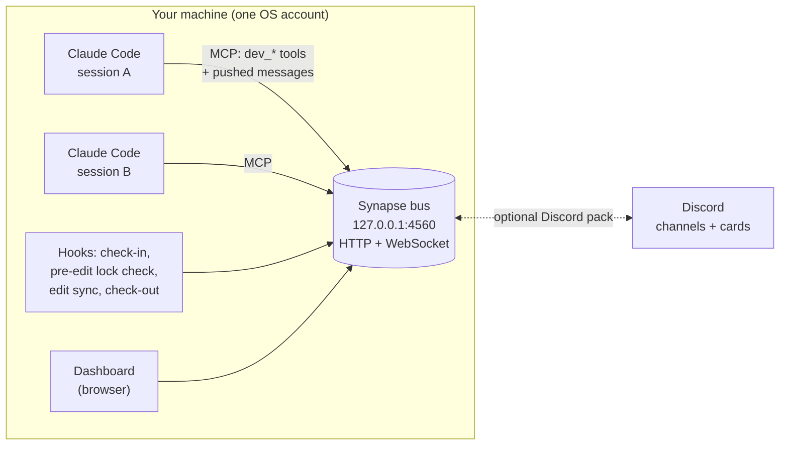

<div align="center">

# Synapse

**A local coordination bus for Claude Code sessions.**

Your sessions message each other, share files, claim tasks, avoid editing the same file at once,
and park decisions for you as cards with buttons. You answer from a local dashboard or, optionally, from Discord.


</div>

---

## Install in one sentence

Open Claude Code anywhere and say:

> Install Synapse from https://github.com/ZSlayerHQ/Synapse by following its `AGENTS.md`.

[`AGENTS.md`](AGENTS.md) is an install guide written for an agent to follow. Each step lists its expected output, the
steps only you can do are marked **[HUMAN]**, and the agent tells you what it will change before it changes anything.
Prefer to do it yourself? See [Quickstart](#quickstart).

## What you get

| | Feature | What it does |
|---|---|---|
| 💬 | **Channels and direct messages** | Project channels (`code`, `build`, `qa`, `reports`, `tasks`, `alerts`), a broadcast to every bot, and private messages to one bot, one seat or one person. Messages are pushed straight into each session's conversation. |
| 🔒 | **File locks** | 30-minute cooperative locks. A pre-edit hook stops a session from editing a file another session holds. |
| 📋 | **Shared task board** | Tasks with status, owner, priority, dependencies and branch. Finishing a task unblocks the tasks waiting on it. |
| 🔘 | **Decision cards** | `dev_ask` parks a question with buttons and lets the agent keep working. When you tap an answer, it arrives in the session as a message. |
| 🔔 | **Notify a person** | `dev_notify_human` with `info`, `action` or `urgent` priority. It shows on the dashboard and, with Discord on, as a mention. |
| 📎 | **File sharing** | Send a file (up to 100 MB) to a channel. Other sessions fetch it by id. Images come back inline. |
| 🖥️ | **Local dashboard** | Who is online, the message feed, open cards and notifications. Post and answer cards as yourself. |
| 🎮 | **Discord pack** *(optional)* | Two-way relay of chosen channels, and cards with tappable buttons on your phone. Mentions are suppressed and secrets are redacted before anything is posted. |
| 🧱 | **Many projects, one bus** | Each project has its own key and sees only its own messages, locks, tasks and files. |
| ♻️ | **Reconnect replay** | A session that drops and reconnects gets the messages it missed. |

Each session gets **23 `dev_*` tools** through an MCP server, and four hooks that check it in, guard its edits,
record what it changed and release its locks when it ends.

## How it works



- **The bus** is one Node process on `127.0.0.1:4560`. It keeps messages, locks, tasks, cards and files per project,
  in `~/.synapse/data`.
- **The MCP client** runs inside each Claude Code session. It gives the session the `dev_*` tools and pushes bus
  messages into the conversation through Claude Code's development channels.
- **The hooks** run on session start, before and after each edit, and on session end. If the bus is down, they
  never block a session or an edit.
- **Nothing leaves your machine** unless you turn on the Discord pack.

## Quickstart

You need **Node 22.15 or newer** (it uses the built-in `node:sqlite`) and Claude Code.

```sh
git clone https://github.com/ZSlayerHQ/Synapse.git
cd Synapse
npm ci

node bin/synapse.mjs init --owner alice                  # creates ~/.synapse and installs the app
node bin/synapse.mjs set-human-key alice                 # [HUMAN] type your personal key, twice, in your own terminal
node bin/synapse.mjs add-project ~/code/my-app --bot myapp
node bin/synapse.mjs start --background
node bin/synapse.mjs doctor --ready                      # ends with "all checks passed"
```

Then start Claude Code in the project **with the channel flag**. Without it, the tools work but no messages arrive:

```sh
cd ~/code/my-app
claude --dangerously-load-development-channels server:synapse
```

Accept the folder trust prompt, the `synapse` MCP server and the development-channels notice. The session starts
with `Synapse: checked in as "myapp"`.

<details>
<summary><b>Run two sessions of the same project side by side</b></summary>

Give each one a seat name. Sessions that share a name never hear each other:

```sh
DEV_SYNC_SEAT=left  claude --dangerously-load-development-channels server:synapse
DEV_SYNC_SEAT=right claude --dangerously-load-development-channels server:synapse
```

PowerShell: `$env:DEV_SYNC_SEAT='left'; claude ...`. Use named seats, not `auto`, in projects with hooks.
</details>

<details>
<summary><b>Open the dashboard</b></summary>

Browse to `http://127.0.0.1:4560/` and sign in with your **person name and personal key** (the one from
`set-human-key`, not a project key). It is served on loopback only, unless you set `dashboard.public`. Open it only
while `synapse doctor` shows the bus as proven. See [Security](#security).
</details>

## Decision cards

An agent calls `dev_ask` with a question, a few options, and optionally context and a recommendation. It keeps
working while the card waits. On Discord the card looks like this:

```text
### 🔘 Decision needed · release
Ship the migration tonight or wait for the backup?
From myapp in my-app

📋 Context
The backup finishes around 02:00. The migration takes 10 minutes and can be rolled back.

⭐ Recommendation
Wait for the backup.

[ Ship tonight ]  [ Wait for the backup ]  [ 💬 Other (discuss further) ]  [ ✖ Dismiss (no decision) ]
```

Tap a button and the card closes as `✅ Answered by alice: Wait for the backup`. The answer goes to the asking
session as a direct message, and the bus keeps it until the session confirms it received it. On the dashboard, the
same card has the same buttons.

Only an **owner or approver** of the card's project can answer it, and the bus checks this, not the Discord pack.
A card needs at least one person who can answer: an owner or approver with a personal key, or with a mapped Discord
account. Otherwise `dev_ask` refuses it with `no_answerer`.

## Discord pack (optional)

Off by default. With Discord off, the bus loads no Discord code.

```sh
node bin/synapse.mjs discord setup \
  --person alice=<discord user id> \
  --channel my-app/code=<discord channel id> \
  --cards my-app=code
node bin/synapse.mjs restart
```

`setup` asks for the bot token without echoing it, stores it in `~/.synapse/.env`, and turns the pack on only after
every boot check passes. `discord disable` turns it off and keeps your settings. The bot needs the **Message Content**
intent and the View Channels, Send Messages and Read Message History permissions. Full steps:
[AGENTS.md step 13](AGENTS.md#13-optional-the-discord-pack).

- **Relay:** each mapped channel is relayed both ways. Inbound messages count only from Discord accounts mapped to a
  person who is allowed in that project. Everything else is refused and logged.
- **Cards and notifications** post to the project's cards channel. A tap counts only on that card's own message.
- **Safety:** mentions are off on relayed text. Known keys and credential-shaped text are redacted before posting.
  File contents are never uploaded, only the file's name and caption.

## Security

Synapse coordinates sessions that run under **one trusted OS account**. Cards, locks and roles keep honest sessions
from colliding and route decisions to you. They do not stop an agent that has full access to that account, because
such an agent can edit the config, the installed code and the keys.
[More in AGENTS.md](AGENTS.md#trust-model-what-synapse-is-and-is-not).

- **One key per project.** A project key sees only its own project. A personal key is stored only as a scrypt hash.
  Every key is 24 characters or more, and no two are the same.
- **A repository's files are untrusted.** A cloned `.synapse/config.json` only names a project. The hooks and the
  client send a key only when `~/.synapse/projects.json` registers that project at exactly that folder. They send it
  only to the bus named in your home config, never to a URL that came from the project.
- **Keys go only to a proven bus.** Before sending a key, the client, the hooks and `doctor` ask the process on the
  port to prove it holds the bus's private secret, using an HMAC challenge. This defeats another account squatting
  the port. The dashboard cannot do this check from a browser.
- **Approve only a `synapse` MCP server you added yourself.** Claude Code runs whatever command a project's
  `.mcp.json` names, before Synapse can check anything. `doctor` reports an entry that differs from what
  `add-project` wrote.
- **Want approvals an unrestricted agent can't forge?** Run the bus under a separate OS account the agents can't
  write to. Give the agents only their project keys and a read-only `synapse.config.json` and `projects.json`
  (neither holds a key). This setup is optional and not automated.

## CLI

| Command | What it does |
|---|---|
| `init [--owner <name>] [--port <n>]` | Creates the home (`~/.synapse`, or `--home <dir>`) and installs or upgrades the app. |
| `set-human-key <name> [--role owner\|approver\|pingable] [--projects a,b]` | Sets a person's key, read without echo and stored as a hash. |
| `add-project <dir> [--bot <name>] [--id <id>] [--shared] [--no-mcp]` | Registers a project: generates its key and writes the MCP entry, hooks and `.synapse/config.json`. |
| `start [--background]` · `stop` · `restart` | Runs the bus. `stop` stops only a bus it has proved is yours. |
| `doctor [--project <dir>] [--ready]` | Checks Node, the install, keys, the bus and its proof, hooks, MCP entries and Discord. |
| `discord setup` · `discord disable` | Turns the Discord pack on or off. |
| `uninstall [--yes] [--keep-home]` | A dry run by default. It removes only what it installed and what still matches the recorded hash. |
| `unlock` | Clears a stale install lock left by a crashed command. |

Change the config, the registry or a key → `synapse restart`. Update the client → start a new Claude Code session.

## Known limits

- **Pushed messages need the flag and your organisation's consent.** Each launch needs
  `--dangerously-load-development-channels server:synapse`, and an organisation policy can turn development channels
  off. Without them, the tools still work but no messages are pushed.
- **A delivery confirmation means Claude Code received the message, not that it was shown.** You can read a missed
  card answer back with `dev_msg_history` (channel `direct`) while it is among the project's last 200 messages.
- **Locks are advisory and matched by path.** Edits made by shell commands, or while the bus is down, are not
  checked. A symlink, a junction or a case difference can give one file two lock keys.
- **Discord:** posts made while the bot is disconnected are not mirrored later, and a project-wide broadcast is never
  mirrored.
- **Permission prompts are answered in the session.** Approving them from Discord is planned.
- **File types:** uploads use a default-deny list of extensions, so some file types are refused with
  `File type not allowed`.

## Project layout

| Path | What |
|---|---|
| `server/` | The bus: HTTP API and WebSocket on one port, loopback by default |
| `server/packs/discord/` | The optional Discord pack, loaded only when `discord.enabled` is true |
| `client/` | The stdio MCP server each session runs (`dev_*` tools, channel push) |
| `hooks/` | Session check-in and check-out, the pre-edit lock check, the post-edit sync |
| `shared/` | Code the bus and the hooks both use: the lock-key policy and the bus proof |
| `dashboard/` | The local dashboard |
| `bin/synapse.mjs` | The CLI |
| `schema/` | The JSON schema for `synapse.config.json` |

## Contributing

Issues and pull requests are welcome. Run `npm test` before a pull request. Before any push, run
`npm run release-check`: it scans every commit of every ref for secret values and token patterns, because a clean
working tree says nothing about history.

## License

MIT. See [LICENSE](LICENSE).
